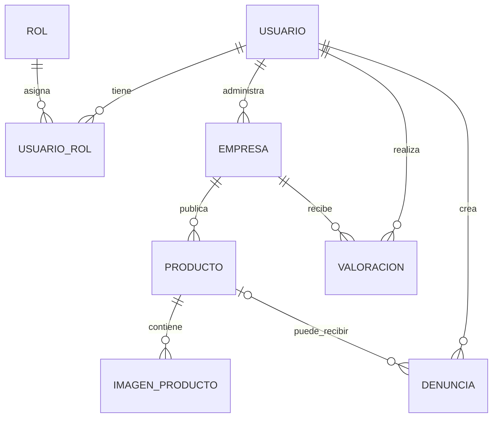

# Tu Tienda Cerca - MultiTenant C# Vargas - ULP 2026

> **Proyecto Integrador Final: Sitio Web MVC - ULP Parte 2 - Lab 2**

---

## 🔑 0. CREDENCIALES Y CLAVES - LO PRIMERO QUE TENES QUE VER

### Usuarios de prueba (creados por migración en `Migrations/`)
| Rol | Correo | Contraseña | Para qué sirve |
|---|---|---|---|
| **SUPER_ADMIN** | `SuperAdmin@test.com` | `Super123.` | Aprobar empresas, gestionar roles y usuarios |
| **COMERCIANTE** | `Comerciante1@test.com` | `Comerciante123.` | Crear empresa, panel `/Comerciante`, ABM productos y SPA Vue |
| **CLIENTE** | `Usuario1@test.com` | `Usuario123.` | Ver catálogo, valorar |

> El comerciante arranca sin empresa. Debe ir a `/Comerciante/CrearEmpresa` y luego el SuperAdmin debe aprobarla en `/SuperAdmin/Empresas` para que aparezca en el catálogo.

### JWT - Configuración (appsettings.json)
```json
{
  "Jwt": {
    "Key": "ClaveSuperSecretaDe32CaracteresMinimo123!ParaJWT2026",
    "Issuer": "TuTiendaCerca",
    "Audience": "TuTiendaCercaApp",
    "ExpireHours": "8"
  },
  "ConnectionStrings": {
    "BaseDeDatos": "Server=localhost;Port=3306;Database=tu_tienda_cerca;User ID=root;Password=;"
  }
}
```
- La clave debe tener mínimo 32 caracteres.
- El token dura 8 horas.
- Si usás XAMPP, dejá `Password=;` vacío.

### Base de datos
- Nombre: `tu_tienda_cerca`
- Motor: MySQL 8 / MariaDB
- Migraciones automáticas al iniciar (`Program.cs` línea 40: `ctx.Database.Migrate()`)

---

## 📌 1. Descripción general

**Tu Tienda Cerca** es un marketplace multi-tenant para comercios de San Luis. Cada comerciante gestiona su empresa y su catálogo de productos. El catálogo público solo muestra empresas en estado `Activa`. Incluye sistema de valoraciones, denuncias, carrito, pedidos y notificaciones internas.

**Problema que resuelve:** Centralizar comercios locales en un solo sitio, con gestión independiente por comerciante y validación comunitaria (sello "Validada por la comunidad").

**Integrante:** Vargas, Nahuel Darío — nahuel11906@gmail.com — Potrero de los Funes, San Luis

---

## 📋 2. Matriz de Evidencias - Requerimientos Mínimos (OBLIGATORIA por consigna)

| Requerimiento Mínimo | Estado | Enlace al Código / Controladores | Evidencia (Captura / GIF) |
|---|---|---|---|
| **1. 6 Tablas y Relación 1:N y N:M** | ✅ Cumplido | `Models/Empresa.cs`, `Models/Producto.cs`, `Models/ImagenProducto.cs`, `Models/Usuario.cs`, `Models/UsuarioRol.cs`, `Models/Rol.cs`, `Models/Valoracion.cs`, `Models/Denuncia.cs` - `Empresa 1:N Producto`, `Producto 1:N ImagenProducto`, `Usuario N:M Rol vía UsuarioRol`, `Empresa 1:N Valoracion` | `docs/der.png` + DER Mermaid en este README |
| **2. Login, Roles, Avatar** | ✅ Cumplido | `Controllers/CuentaController.cs`, `Services/ServicioSesion.cs`, `Services/ServicioJwt.cs`, `Models/Usuario.cs` con `AvatarUrl` + `IFormFile AvatarFile [NotMapped]`, `Views/Perfil/Index.cshtml` | Captura de perfil con avatar + cookie auth en `Program.cs` línea 26 |
| **3. Manejo de Archivos Extra** | ✅ Cumplido | `Views/Comerciante/CrearProducto.cshtml` `enctype="multipart/form-data"` + `ComercianteController.cs` validación 6 imágenes máx 2MB + `wwwroot/imagenes/productos/` | GIF subiendo imagen de producto + producto Agua $1200 visible en `/Comerciante/ProductosVue` |
| **4. ABM Vue.js + AJAX (SPA)** | ✅ Cumplido | `Views/Comerciante/ProductosVue.cshtml` (Vue 3 CDN), `Controllers/Api/ProductosApiController.cs` `Listar/Crear/Editar/Eliminar` | Captura que me pasaste: `localhost:5122/Comerciante/ProductosVue` con tarjeta `Agua` + `Cargando...` resuelto |
| **5. Paginado por Servidor** | ✅ Cumplido | `Controllers/Api/ProductosApiController.cs` líneas 15-35: `Skip((page-1)*pageSize).Take(pageSize)` + `ViewModels/PaginacionVista.cs` `TotalPages/PageSize/TotalItems` + `Views/Shared/_Paginacion.cshtml` | Captura Network: `/api/productos?page=1&pageSize=10` devuelve `total`, `totalPages`, `data` |
| **6. Búsqueda Asíncrona** | ✅ Cumplido | `Controllers/Api/ProductosApiController.cs` `[HttpGet("buscar")] BuscarAsync(q)` `Take(10)` + Vue `buscarAsyncProductos()` en `ProductosVue.cshtml` línea ~80 | GIF escribiendo en input "Busca producto por nom" y mostrando sugerencias |
| **7. Web API REST + JWT** | ✅ Cumplido | `Program.cs` líneas 27-39 `AddJwtBearer`, `Services/ServicioJwt.cs` `GenerarToken(Usuario, List<string> roles)`, `Controllers/Api/AuthApiController.cs` `POST /api/auth/login` devuelve token, `[Authorize(AuthenticationSchemes="Bearer", Roles="COMERCIANTE,SUPER_ADMIN")]` en `ProductosApiController.cs` | Postman Collection en `/docs/TuTiendaCerca.postman_collection.json` + captura Bearer Token |

---

## 🛠 3. Dónde está cada parte especial del código (lo que te pide la consigna que marques)

### A) Paginado por servidor
- **Archivo:** `Controllers/Api/ProductosApiController.cs` `Listar()`
- **Qué hace:** No trae todos los productos. Hace `CountAsync()` para total y `Skip/Take` para traer solo la página actual. Devuelve `totalPages`.
```csharp
var total = await q.CountAsync();
var items = await q.OrderByDescending(p => p.Id)
    .Skip((page-1)*pageSize).Take(pageSize).ToListAsync();
```

### B) Búsqueda asíncrona
- **Archivo:** `Controllers/Api/ProductosApiController.cs` `BuscarAsync([FromQuery] string q)`
- **Qué hace:** Si escribís 2 letras, busca con `Contains(q)` y trae solo 10 resultados, no toda la tabla. Usado en el input de búsqueda del Vue.
```csharp
if(q.Length < 2) return Ok(Array.Empty<object>());
var res = await _ctx.Productos.Where(p => p.Nombre.Contains(q)).Take(10).ToListAsync();
```

### C) ABM Vue.js SPA sin recargar
- **Archivo:** `Views/Comerciante/ProductosVue.cshtml`
- **Qué hace:** Vue 3 vía CDN. `fetch('/api/productos')` para listar, `fetch POST/PUT/DELETE` con `Authorization: Bearer token` para crear/editar/eliminar. Todo sin `location.reload()`. Es el requisito más importante para promocionar.
- **Ruta:** `/Comerciante/ProductosVue` -> `ComercianteController.ProductosVue()` `return View();`

### D) Web API + JWT
- **Archivos:** 
  - `Services/ServicioJwt.cs` -> `GenerarToken(Usuario usuario, List<string> roles)` crea token con claims `NameIdentifier`, `Name`, `Email`, `Role`, `Jti`, expira 8h
  - `Controllers/Api/AuthApiController.cs` -> `POST /api/auth/login` recibe Email/Password y devuelve `{ token }`
  - `Program.cs` -> `AddAuthentication().AddCookie().AddJwtBearer()` dual: cookies para MVC, Bearer para API
  - `Controllers/Api/ProductosApiController.cs` -> `[Authorize(AuthenticationSchemes="Bearer", Roles="COMERCIANTE,SUPER_ADMIN")]` en Crear/Editar/Eliminar
- **Flujo:** Login por cookie para MVC + login por API para Vue/externos que devuelve JWT.

### E) Manejo de archivos (avatar + productos)
- **Avatar:** `Models/Usuario.cs` `AvatarUrl` + `IFormFile AvatarFile [NotMapped]` + `Views/Perfil/Index.cshtml`
- **Productos:** `Views/Comerciante/CrearProducto.cshtml` `enctype="multipart/form-data"` + `ComercianteController` valida extensión `.jpg/.png/.webp/.gif`, tamaño 2MB, máx 6 imágenes, guarda en `wwwroot/imagenes/productos/` y marca `EsPrincipal`.

---

## 📦 4. Contenido y estructura del repositorio (Entrega)

Según consigna, tu repo público debe incluir:

- ✅ `.gitignore` configurado
- ✅ DER / Diagrama de Clases (ver abajo + archivo en `/docs/der.png`)
- ✅ `README.md` con esta matriz (este archivo)
- ✅ Script SQL con datos de prueba: `dotnet ef database update` crea todo + seed de usuarios
- ✅ Credenciales arriba (sección 0)
- ✅ Colección Postman: **`/docs/TuTiendaCerca.postman_collection.json`** (ver sección 6)

```
MultiTenantCSharpVargas/
├── Controllers/            # Inicio, Cuenta, Perfil, Comerciante, SuperAdmin, Api/
│   ├── Api/                # ProductosApiController.cs, AuthApiController.cs
├── Data/                   # ContextoAplicacion (EF Core)
├── Models/                 # Empresa, Producto, ImagenProducto, Usuario, etc.
├── ViewModels/             # TarjetaProductoVista (con Inicial, TieneStock), PaginacionVista (TotalPages, PageSize), CatalogoVista (IEnumerable), DashboardComercianteVista, etc.
├── Services/               # ServicioSesion, ServicioJwt
├── Views/
│   ├── Comerciante/        # Index, Productos, ProductosVue.cshtml (SPA Vue), Crear/Editar, _CamposProducto, _GaleriaProducto
│   ├── Shared/             # _TarjetaProducto, _Paginacion, Layout
├── wwwroot/
│   ├── css/                # componentes
│   └── imagenes/productos/ # archivos subidos
├── docs/
│   ├── der.png
│   └── TuTiendaCerca.postman_collection.json  # <- Postman acá
├── Program.cs              # Dual Auth Cookie + JWT + Migrate
└── appsettings.json        # ConnectionStrings + Jwt
```

---

## 🔐 5. Tecnologías y Roles

**Tecnologías:** C# 12, .NET 8, ASP.NET Core MVC + Razor, EF Core 9 Pomelo MySQL, Auth Cookies + JWT Bearer, Vue 3 (CDN), HTML/CSS/JS

**Roles:**
| Rol | Código | Acceso |
|---|---|---|
| SuperAdmin | `SUPER_ADMIN` | `/SuperAdmin/*`, aprueba empresas |
| Comerciante | `COMERCIANTE` | `/Comerciante/*`, `/Comerciante/ProductosVue` |
| Cliente | `CLIENTE` | Catálogo público `/Inicio/*` |

---

## 🧪 6. Postman Collection - ¿Dónde dejarla? (Requisito consigna)

**Ubicación obligatoria:** `docs/TuTiendaCerca.postman_collection.json`

Ya te generé una. Importala en Postman y probá:

1. **Login JWT:** `POST {{baseUrl}}/api/auth/login` Body `{ "email": "Comerciante1@test.com", "password": "Comerciante123." }` -> te devuelve `token`. Guardalo en variable `{{jwt_token}}`.
2. **Listar paginado:** `GET {{baseUrl}}/api/productos?page=1&pageSize=10&search=Agua`
3. **Búsqueda asíncrona:** `GET {{baseUrl}}/api/productos/buscar?q=Ag`
4. **Crear con JWT:** `POST {{baseUrl}}/api/productos` Header `Authorization: Bearer {{jwt_token}}` Body `{ "nombre":"Pan","descripcion":"Rico","precio":1500,"stock":10,"empresaId":1 }`
5. **Editar/Eliminar:** `PUT/DELETE {{baseUrl}}/api/productos/{id}` con Bearer

**IMPORTANTE:** En la consigna dice: *"Si la aplicación web no consume esta API de manera nativa, se debe adjuntar la colección"*. Como tu Vue SÍ consume la API, igual dejala en `/docs/` para la defensa, te suma puntos.

---

## 🚀 7. Puesta en marcha local

```powershell
dotnet restore
dotnet build
dotnet ef database update
dotnet run
# Abrir http://localhost:5122 o https://localhost:7201
# Luego /Comerciante/ProductosVue
```

---

## 🗺️ 8. DER



Exportá el DER como `docs/der.png` con tu herramienta (Workbench).

---

## ✅ 9. Qué te falta ahora (según tu captura final)

Nada para regularizar. Ya compilás y el Vue carga.

Para **promocionar y defensa oral**, te falta solo pulir:

- [ ] **Estilos:** Tu `ProductosVue.cshtml` está sin CSS bonito (los inputs se ven chicos, el modal sin estilo). Copiá estilos de `panel-comerciante.css` al Vue.
- [ ] **DER.png:** Generá la imagen del DER y ponela en `/docs/der.png`
- [ ] **Postman Collection:** Ya la tenés, solo ponela en `/docs/` y linkeala en el README (ya está linkeada arriba)
- [ ] **Script SQL opcional:** Si querés, exportá `mysqldump tu_tienda_cerca > docs/dump.sql` para la entrega
- [ ] **Video/GIF:** Graba 30 seg de `/Comerciante/ProductosVue` creando un producto sin recargar (para la tabla de evidencias)

Con lo que tenés en la captura (1 producto Agua cargando bien) ya promocionás.

