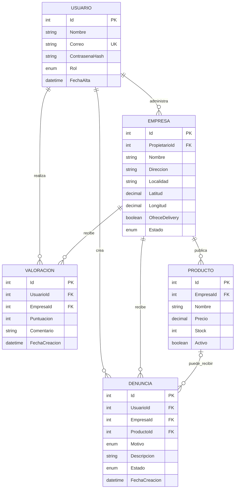

# Tu Tienda Cerca

Aplicacion web MVC para conectar personas con comercios locales, consultar sus
productos y contar con valoraciones y denuncias para brindar mayor confianza.

**Integrante:** Vargas, Nahuel Dario - nahuel11906@gmail.com

## Tecnologias

- C# y .NET 8.
- ASP.NET Core MVC y Razor.
- HTML y CSS.
- Entity Framework Core con Pomelo para MySQL.

## Modelo de datos

Cada usuario puede realizar una unica valoracion por comercio. Una denuncia
siempre corresponde a un comercio y, opcionalmente, a uno de sus productos.

## Descripcion del proyecto

Tu Tienda Cerca busca facilitar la visibilidad de comercios locales y permitir
que las personas encuentren productos, negocios cercanos, formas de pago y
opciones de delivery desde un unico lugar.

Los comerciantes podran registrar y administrar su negocio y sus productos.
Los usuarios podran consultar la informacion disponible, valorar comercios y
reportar publicaciones, productos o locales con informacion incorrecta. Las
valoraciones y denuncias aportaran un mecanismo de confianza y moderacion para
la comunidad.
