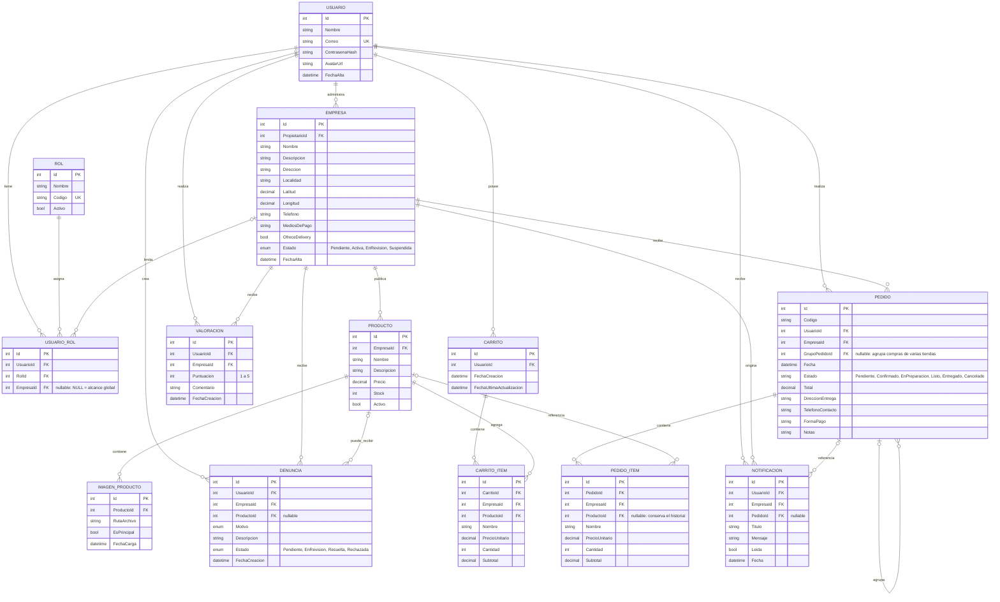
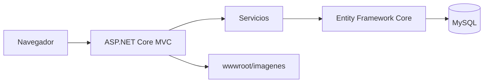

# Tu Tienda Cerca

Aplicación web MVC para conectar personas con comercios locales: permite
descubrir comercios y productos, y ofrece a cada comerciante un panel para
administrar su empresa y su catálogo. El acceso está separado por roles y el
catálogo público solo muestra empresas activas.

**Integrante:** Vargas, Nahuel Darío — nahuel11906@gmail.com

---

## Estado del proyecto

| Módulo | Estado |
|---|---|
| Registro, login, logout y sesión por cookies | ✅ |
| Perfil de usuario con avatar y cambio de contraseña | ✅ |
| Roles en base de datos y autorización por rol | ✅ |
| Administración de roles y asignación por usuario (Super Admin) | ✅ |
| Alta de empresa por el comerciante | ✅ |
| Aprobación, revisión y suspensión de empresas (Super Admin) | ✅ |
| Catálogo público con vista por empresa y por producto | ✅ |
| Búsqueda y paginación del catálogo | ✅ |
| CRUD de productos del comerciante | ✅ |
| Imágenes de producto con validación y imagen principal | ✅ |
| Modelo y tablas de valoraciones, denuncias, carrito y pedidos | ✅ (modelo listo) |
| Pantallas de valoraciones, denuncias, carrito y pedidos | ⏳ próximas etapas |
| Pruebas automatizadas | ⏳ pendiente |

---

## Funcionalidades por rol

### Visitante / Cliente

- Ver el catálogo público sin iniciar sesión.
- Alternar entre **Por empresa** y **Por producto**.
- Buscar por nombre, localidad o comercio.
- Ver el detalle de un comercio y de cada producto.
- Registrarse, iniciar sesión y editar su perfil (nombre, avatar y contraseña).
- Ver el sello **“Validada por la comunidad”** cuando un comercio tiene al menos
  3 valoraciones y un promedio de 4 o más.

### Comerciante

- Crear su empresa (queda en estado `Pendiente`).
- Ver el estado de su empresa y sus métricas básicas.
- Crear, editar, activar, dar de baja y eliminar productos.
- Subir hasta 6 imágenes por producto (JPG, PNG, WEBP o GIF, máximo 2 MB cada una).
- Elegir la imagen principal y eliminar imágenes existentes.
- Ver su comercio en el catálogo público cuando está aprobado.

### Super Administrador

- Panel con totales de usuarios, empresas, empresas pendientes, roles y pedidos.
- Crear usuarios y asignarles un rol y, opcionalmente, una empresa.
- Crear, editar, activar y desactivar roles.
- Asignar o quitar roles a cada usuario, con alcance global o por empresa.
- Aprobar, poner en revisión o suspender empresas.
- Recibir avisos internos: cada cambio de estado de una empresa genera una
  `Notificacion` para su propietario.
- Protección del rol `SUPER_ADMIN`: no se puede desactivar, cambiar su código,
  quitar el último Super Administrador ni quitarte tu propio rol.

---

## Tecnologías

- C# 12 y .NET 8.
- ASP.NET Core MVC y Razor.
- Entity Framework Core 9 con Pomelo para MySQL.
- Autenticación por cookies y autorización por roles.
- HTML, CSS y JavaScript mínimo (confirmaciones de borrado).
- Docker para despliegue.

---

## Estructura del proyecto

```
MultiTenantCSharpVargas/
├── Controllers/            # Inicio, Cuenta, Perfil, Comerciante, SuperAdmin
├── Data/                   # ContextoAplicacion (EF Core)
├── Migrations/             # Migración inicial + seed de usuarios
├── Models/                 # Entidades del dominio
│   └── Vistas/             # Modelos de vista del catálogo y las tarjetas
├── Services/               # PasswordHasher y ServicioSesion
├── Views/
│   ├── Comerciante/        # Panel y CRUD de productos
│   ├── Cuenta/             # Login, registro y acceso denegado
│   ├── Inicio/             # Catálogo, detalle de empresa y producto, error
│   ├── Perfil/             # Datos personales, avatar y contraseña
│   ├── Shared/             # Layout, tarjetas reutilizables, paginación y error
│   └── SuperAdmin/         # Usuarios, roles, empresas y panel
├── wwwroot/
│   ├── css/                # Estilos generales y por componente
│   └── imagenes/           # Favicon y archivos subidos por usuarios
├── Dockerfile
└── Program.cs
```

### Componentes reutilizables

- `Views/Shared/_TarjetaEmpresa.cshtml`: tarjeta de comercio.
- `Views/Shared/_TarjetaProducto.cshtml`: tarjeta de producto.
- `Views/Shared/_Paginacion.cshtml`: paginación del catálogo.
- `wwwroot/css/componentes/tarjetas.css`: estilos compartidos por ambas tarjetas.

Las mismas tarjetas se usan en la portada, en el detalle de empresa y en el
panel del comerciante.

---

## Modelo de datos

El sistema usa una **base única compartida** con discriminación por `EmpresaId`.
Las entidades globales (`Usuario`, `Carrito`, `Pedido`) pueden relacionarse con
varias empresas; los ítems y los subpedidos conservan `EmpresaId` para impedir
asociaciones entre empresas distintas.

### DER completo



### Reglas del modelo

- `Usuario.Correo` es único.
- Un usuario puede tener varios roles; `UsuarioRol.EmpresaId` limita el alcance
  del rol. `NULL` significa alcance global.
- Una `Valoracion` es única por usuario y empresa, con puntuación de 1 a 5.
- Una `Denuncia` siempre pertenece a una empresa y puede apuntar a un producto.
- `Pedido` tiene una clave alternativa `(Id, EmpresaId)` y `PedidoItem` usa
  claves compuestas `(PedidoId, EmpresaId)` y `(ProductoId, EmpresaId)` para
  reforzar el aislamiento entre empresas.
- `Pedido.GrupoPedidoId` permite agrupar en un mismo grupo de compra un pedido
  por cada tienda involucrada.
- Las imágenes se guardan en disco y en la base solo se persiste la ruta pública.

### Diagrama de despliegue



---

## Roles y permisos

| Rol | Código | Alcance | Acceso |
|---|---|---|---|
| Super Administrador | `SUPER_ADMIN` | Global | Panel completo, usuarios, roles y empresas |
| Administrador | `ADMIN` | Global o por empresa | Reservado para administración |
| Comerciante | `COMERCIANTE` | Global o por empresa | Panel de su empresa y productos |
| Cliente | `CLIENTE` | Global | Catálogo y perfil |

Los roles inactivos no se incluyen en la sesión. Si un administrador cambia los
roles de un usuario que ya tiene sesión abierta, el usuario debe volver a
iniciar sesión para que el cambio se refleje en su cookie.

---

## Puesta en marcha local

### Requisitos

- .NET 8 SDK.
- MySQL 8 (o MariaDB compatible).
- Herramientas de EF Core (opcional, si ya están las migraciones):

```powershell
dotnet tool install --global dotnet-ef
```

### 1. Restaurar y compilar

```powershell
dotnet restore
dotnet build
```

### 2. Configurar la conexión

Crear `appsettings.Local.json` en la raíz del proyecto (no se versiona):

```json
{
  "ConnectionStrings": {
    "BaseDeDatos": "Server=localhost;Port=3306;Database=tu_tienda_cerca;User ID=root;Password=tu_clave;"
  }
}
```

También podés usar la variable de entorno
`ConnectionStrings__BaseDeDatos`.

Si no hay cadena configurada, la aplicación arranca igual y muestra el catálogo
vacío, pero las pantallas que necesitan la base muestran un error amigable.

### 3. Aplicar migraciones

La aplicación aplica las migraciones automáticamente al iniciar. También podés
hacerlo manualmente:

```powershell
dotnet ef database update
```

### 4. Ejecutar

```powershell
dotnet run
```

Abrir `http://localhost:5000` (o el puerto que indique la consola).

---

## Usuarios de prueba

Se crean por migración. Las contraseñas son solo para desarrollo.

| Rol | Correo | Contraseña |
|---|---|---|
| Super Administrador | `SuperAdmin@test.com` | `Super123.` |
| Administrador | `Admin1@test.com` | `Admin123.` |
| Comerciante | `Comerciante1@test.com` | `Comerciante123.` |
| Cliente | `Usuario1@test.com` | `Usuario123.` |

> El comerciante arranca sin empresa: debe crearla desde su panel y luego el
> Super Administrador debe aprobarla para que aparezca en el catálogo.
> Cambiar estas contraseñas antes de publicar la aplicación.

---

## Rutas principales

| Ruta | Descripción | Acceso |
|---|---|---|
| `/` o `/Inicio/Inicio` | Catálogo (vista por empresa) | Público |
| `/Inicio/Inicio?vista=productos` | Catálogo por producto | Público |
| `/Inicio/Empresa/{id}` | Detalle de comercio activo | Público |
| `/Inicio/Producto/{id}` | Detalle de producto activo | Público |
| `/Cuenta/Registro` | Crear cuenta | Público |
| `/Cuenta/Login` | Iniciar sesión | Público |
| `/Perfil` | Datos, avatar y contraseña | Autenticado |
| `/Comerciante` | Panel del comerciante | `COMERCIANTE` |
| `/Comerciante/Productos` | Listado y gestión de productos | `COMERCIANTE` |
| `/Comerciante/CrearProducto` | Alta de producto | `COMERCIANTE` |
| `/Comerciante/EditarProducto/{id}` | Edición e imágenes | `COMERCIANTE` |
| `/SuperAdmin` | Panel de administración | `SUPER_ADMIN` |
| `/SuperAdmin/Usuarios` | Usuarios y acceso a sus roles | `SUPER_ADMIN` |
| `/SuperAdmin/Roles` | Alta, edición y estado de roles | `SUPER_ADMIN` |
| `/SuperAdmin/Empresas` | Aprobación y suspensión | `SUPER_ADMIN` |

---

## Manejo de errores

- `UseExceptionHandler("/Inicio/Error")` captura errores no controlados en
  producción y muestra una vista amigable sin exponer stack traces.
- `UseStatusCodePagesWithReExecute("/Inicio/Error/{0}")` cubre 400, 403, 404,
  405 y otros códigos.
- La vista de error muestra el código, un mensaje según el caso y el
  identificador de la solicitud para poder buscarlo en los logs.
- Los errores de base de datos se registran con `ILogger` y se muestran como
  mensajes de validación o avisos (`TempData`) en los formularios.
- El catálogo captura fallas de conexión y muestra un aviso en lugar de romper
  la portada.
- Todos los formularios POST usan antiforgery. Si el token vence, se muestra la
  página de error amigable.
- En desarrollo se mantiene `DeveloperExceptionPage` para depurar.

---

## Imágenes

- Avatares: `wwwroot/imagenes/avatares`.
- Productos: `wwwroot/imagenes/productos`.
- Extensiones permitidas: JPG, JPEG, PNG, WEBP y GIF.
- Tamaño máximo: 2 MB por archivo.
- Máximo 6 imágenes por producto.
- Si se reemplaza o elimina una imagen, también se borra el archivo del disco.
- La ruta pública se guarda en la base; nunca se guarda el archivo en la base.

> En Render el disco es efímero: las imágenes subidas se pierden en cada
> redeploy. Para producción conviene usar un almacenamiento externo (S3,
> Cloudinary, etc.).

---

## Docker y Render

### Docker local

```powershell
docker build -t tu-tienda-cerca .
docker run -p 10000:10000 `
  -e ConnectionStrings__BaseDeDatos="Server=host;Port=3306;Database=tu_tienda_cerca;User ID=usuario;Password=clave;" `
  tu-tienda-cerca
```

La aplicación escucha en `http://+:10000` por defecto y respeta la variable
`PORT` que inyecta Render.

### Render

1. Crear un **Web Service** apuntando al repositorio y al `Dockerfile`.
2. Configurar la variable de entorno:
   - `ConnectionStrings__BaseDeDatos` = cadena de conexión MySQL.
3. Opcional: `ASPNETCORE_ENVIRONMENT=Production` (ya viene en el Dockerfile).
4. El servicio debe usar el puerto `10000` o dejar que Render inyecte `PORT`.

> La aprobación de empresas y el catálogo funcionan igual en Render, pero las
> imágenes subidas se pierden al redeployar por el filesystem efímero.

---

## Limitaciones y próximos pasos

- No hay pantallas para valoraciones, denuncias, carrito ni pedidos: las tablas
  y relaciones ya están creadas y listas para las próximas etapas.
- No hay pruebas automatizadas todavía.
- La búsqueda es por coincidencia simple (`LIKE`) y no usa índices de texto
  completo.
- La geolocalización (`Latitud`/`Longitud`) está modelada pero todavía no se
  usa para ordenar por cercanía.
- El envío de notificaciones es interno (tabla `Notificaciones`); no hay correo
  ni push.
- Las fotos se almacenan en el filesystem local, con la limitación de Render
  indicada arriba.
